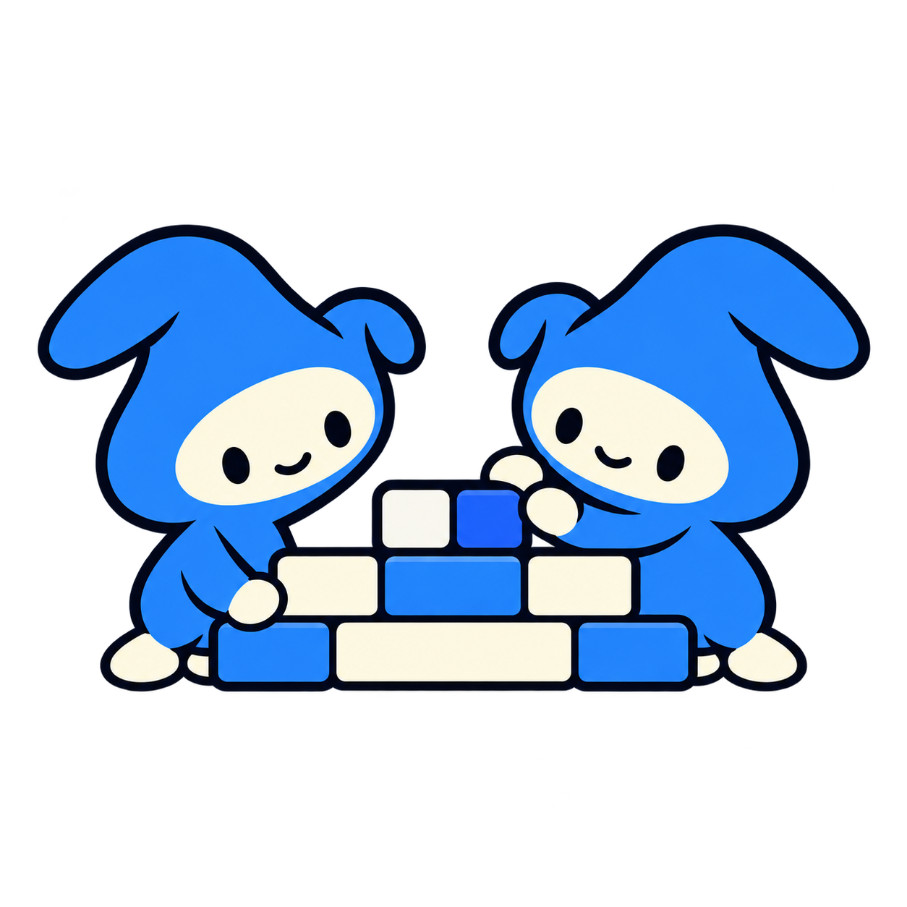

<p align="center"></p>

# TeamCTL

**Create autonomous teams of agents.**

TeamCTL is an open-source platform for defining how agents work together. Choose the roles, structure and communication. Run the team in the background, and share its definition so others can use it or make it their own.

Start with two agents exploring a question, or define an organization with leads, specialists and project teams.

Supports **Claude Code, Codex, OpenCode and Gemini CLI**. Mix tools or run several agents with the same one.

[Docs](https://teamctl.run/getting-started/) · [Examples](https://github.com/Alireza29675/teamctl/tree/main/examples) · [Releases](https://github.com/Alireza29675/teamctl/releases) · [MIT license](https://github.com/Alireza29675/teamctl/blob/main/LICENSE)

## Define the team around your idea

- **Research partners.** Two agents ask each other questions, compare evidence and review their conclusions. Neither needs to manage the other.
- **A project team.** A lead coordinates builders and reviewers. Fixing a bug could be one task for this team.
- **An organization.** Define shared roles, reporting relationships and separate project rosters with their own channels.

These are possible team designs. You write the roles and configure tools, relationships and communication. TeamCTL provides the sessions and messaging that let the agents act on that setup.

## Run it in the background

Once the team is running, agents can exchange questions, delegate work and report results according to their roles. Close the dashboard and their sessions continue. Check back to follow the conversation, give direction or inspect the work.

Background work requires a running host, active agent sessions and provider access. The roles and permissions you configure shape what the agents can do.

## Set up your first team

You'll need macOS or Linux, `tmux`, `git`, and the agent runtimes you want to use, installed and signed in.

```sh
curl -fsSL https://teamctl.run/install | sh
```

Make sure `~/.local/bin` is on your PATH. Inside your project:

```sh
teamctl init
teamctl validate
teamctl up
teamctl ui
```

Choose a starter, review its roles and runtimes, and configure any interfaces it needs. `init` creates the team files; `up` starts the agents. The picker defaults to Ideate & Build, a Claude Code starter. Choose Guided for conversational setup with Claude Code and the TeamCTL plugin. Edit the roster to mix runtimes.

Agent usage follows your providers' plans and limits. TeamCTL is open source; model usage may still cost money.

## What you configure

- **Agent tools and models.** Choose Claude Code, Codex, OpenCode or Gemini CLI for each named session, then select its model.
- **Roles and relationships.** Write what each agent should do, who it reports to and who it can message.
- **Direct messages and channels.** Let agents exchange instructions, questions and results.
- **How you follow the work.** Inspect sessions, messages and approval requests in the terminal UI. Configure Telegram to interact from your phone.

Your team definition lives in `.team/`. Roles are Markdown files; team structure and configuration use YAML. You can define peers without reporting links, or leads and specialists with explicit relationships. Separate project rosters have their own communication scope.

## Explore example teams

Each example is a team definition you can inspect and adapt.

| Team | Roles and work |
| --- | --- |
| [Personal research](examples/personal-research/) | A researcher and curator share questions and findings. |
| [Product team](examples/product-team/) | Leads coordinate builders and cross-model reviewers. |
| [Open-source maintainer](examples/oss-maintainer/) | Specialists triage issues, propose changes and prepare releases for review. |
| [Autonomous prototyper](examples/autonomous-prototyper/) | Researchers and builders investigate ideas and develop prototypes. |

[Explore all examples](examples/).

## One possible structure: a lead and builder

A lead using Claude Code and a builder using Codex, connected through one channel. This is a project-roster excerpt for `.team/projects/my-team.yaml`; use a generated starter for the complete folder and role files.

```yaml
version: 2
project:
  id: my-team

channels:
  - name: work
    members: [lead, builder]

managers:
  lead:
    runtime: claude-code
    role_prompt: roles/lead.md

workers:
  builder:
    runtime: codex
    role_prompt: roles/builder.md
    reports_to: lead
```

The role files tell the lead how to delegate and the builder how to respond. The reporting relationship records the structure; the instructions guide how the agents act.

For a peer research pair, define two agents with research roles, allow them to communicate and omit `reports_to`. A manager is optional. Start from a complete team configuration and validate any changes.

## Share a team definition

Share the intended configuration and role files in a repository or as an example. Others can change the roles, tools and structure to fit their work.

Document the required tools and any local paths. Each person supplies their own accounts and permissions. Keep credentials, private messages and runtime state out of the shared files.

## How it works

TeamCTL supervises real agent CLI processes in `tmux`. A SQLite-backed MCP mailbox carries their messages. Closing the dashboard leaves the sessions running in the background while your host and provider access remain available.

Each agent has its own session and conversation history. Messages connect the sessions; they do not automatically merge their context. Roles can cover coding, research or review, depending on the tools and access you configure.

Agents can explicitly request your approval. Their instructions and runtime permissions define action boundaries; the mailbox is not a universal action gate or sandbox. Local supervision can still use cloud models.

```sh
teamctl status     # inspect the team
teamctl down       # stop it
```

## Follow the work

`teamctl ui` shows the agents, their messages and live terminal sessions. You can inspect the conversation, give direction or connect to a session.

<p></p>

[Terminal UI guide](https://teamctl.run/reference/teamctl/) · [Telegram setup](https://teamctl.run/guides/telegram-bot/) · [Cost and rate limits](https://teamctl.run/cost/)

## Why I built it

I wanted to create different kinds of agent teams and let them work together in the background. TeamCTL provides the platform; the team definition captures how I want the agents to work.

I started TeamCTL on [April 24, 2026](https://github.com/Alireza29675/teamctl/commit/601528b0c1ae759bbeed3873d8407ff1993040e8), five months before [Dots was announced](https://openai.com/index/introducing-dots/).

TeamCTL is for people who want to define their own way for agents to collaborate, then run and share that setup.

## Build on it

[Read the docs](https://teamctl.run), explore the [example teams](https://github.com/Alireza29675/teamctl/tree/main/examples), or [open an issue](https://github.com/Alireza29675/teamctl/issues).

Small teams, reproducible workflows and clear improvements are welcome.

## Brand assets

Use the [head logo](docs/public/brand/teamctl-head.svg) for compact branding and the [teamwork illustration](docs/public/brand/teamwork.png) for larger placements. The [brand guide](https://teamctl.run/brand/) covers colours, typography and spacing.

## License

[MIT](LICENSE).
