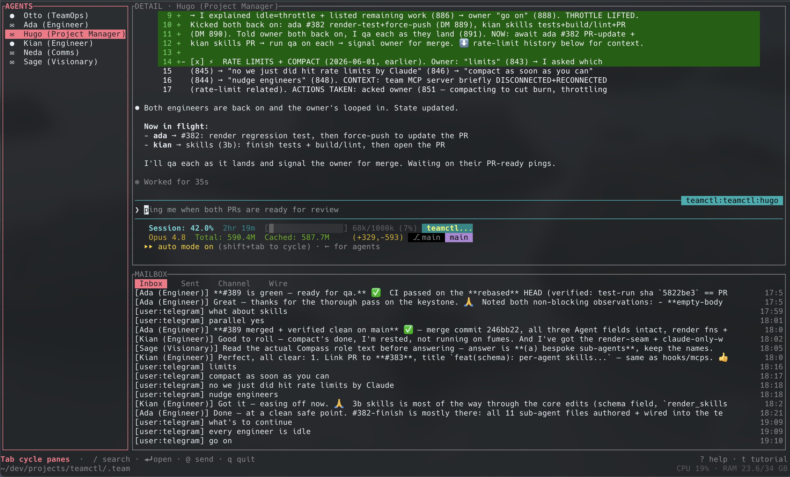

<p align="center">
  
</p>

# TeamCTL: Create autonomous teams of agents.

TeamCTL is an open-source orchestrator for agents that work together. Define their roles, structure and communication, then run the team in the background on your own machine.

A personal assistant, two research partners, a product team, or an organization with leads and specialists: you shape the team around the work. Its definition is code you can store, version and share with Git.

Mix **Claude Code, Codex, OpenCode and Gemini CLI** in one team, or use the same runtime for several agents.

[Website](https://teamctl.run/) · [Documentation](https://teamctl.run/getting-started/) · [Example teams](examples/) · [Releases](https://github.com/Alireza29675/teamctl/releases)

## Start your first team

You'll need **macOS or Linux**, `tmux`, `git`, and the agent runtimes you choose installed and signed in.

### 1. Install

```sh
curl -fsSL https://teamctl.run/install | sh
```

The installer supplies `teamctl`, `team-mcp`, `team-bot` and `teamctl-ui` in `~/.local/bin`. Add that directory to your PATH if needed.

### 2. Define the team

Inside the project where you want your agents to work:

```sh
teamctl init
```

Choose a starter and review its generated `.team/` files before starting it. The interactive picker defaults to **Ideate & Build**, a four-agent Claude Code team. You can edit its roles, runtimes and models, or start from a different [example](examples/).

For conversational setup, choose **Guided** or run `teamctl init --template guided`. Guided requires Claude Code and the [TeamCTL plugin](plugins/claude-code/). If the plugin is not installed, run:

```sh
claude plugin marketplace add Alireza29675/teamctl --scope user
claude plugin install teamctl@teamctl --scope user
```

Starter templates create configuration without starting agents. Guided can also offer to start the team. Configure any accounts, tools and interfaces the chosen team needs before bringing it up; `teamctl bot setup` can help connect Telegram.

### 3. Run and inspect

```sh
teamctl validate
teamctl up
teamctl ui
```

`validate` checks the configuration, `up` starts the sessions, and `ui` opens the terminal dashboard. Closing the dashboard leaves the agents running in the background.

[Full setup guide](https://teamctl.run/getting-started/) · [Telegram setup](https://teamctl.run/guides/telegram-bot/)

## Define roles, structure and communication

Your team's blueprint lives in `.team/`: YAML describes the structure; Markdown describes the roles.

```text
.team/
├── team-compose.yaml       # Shared configuration and project imports
├── projects/
│   └── my-team.yaml        # Agents, runtimes and communication
└── roles/
    ├── lead.md
    └── builder.md
```

For example, a lead using Claude Code can coordinate a builder using Codex through a shared channel:

```yaml
# .team/projects/my-team.yaml (illustrative roster excerpt)
version: 2
project:
  id: my-team
  name: My team
  cwd: ..

channels:
  - name: work
    members: [lead, builder]

managers:
  lead:
    runtime: claude-code
    role_prompt: roles/lead.md

workers:
  builder:
    runtime: codex
    role_prompt: roles/builder.md
    reports_to: lead
```

This excerpt needs a root `team-compose.yaml` and the referenced role files. Use `teamctl init` or a complete [example team](examples/product-team/) for a runnable starting point.

The roles describe how the lead coordinates work and how the builder responds. You can also define peers without reporting relationships, give agents different models and tools, and control who can send direct messages or post to channels.

[Team design](https://teamctl.run/concepts/teams/) · [Configuration reference](https://teamctl.run/reference/team-compose-yaml/) · [Channels](https://teamctl.run/concepts/channels/)

## Follow the work

`teamctl ui` brings the roster, mailbox and actual agent terminal sessions into one view. Read conversations, inspect sessions, give direction and handle agent-requested approvals. Configure Telegram when you want to talk to your team from your phone.

<p align="center">
  
</p>

Common commands:

| Command | What it does |
| --- | --- |
| `teamctl status` | Inspect the current team's sessions. |
| `teamctl ps` | List running teams across your machine. |
| `teamctl send my-team:lead "Review the current plan"` | Send a message to an agent. |
| `teamctl reload` | Apply changes to the team configuration. |
| `teamctl down` | Stop sessions while keeping team files and state. |

[CLI and terminal UI reference](https://teamctl.run/reference/teamctl/)

## Choose your agent tools

Each agent runs a real CLI process with its own session and conversation. Choose a runtime per agent, then configure its model, role and tools.

| Runtime | Configuration value | Required binary |
| --- | --- | --- |
| Claude Code | `claude-code` | `claude` |
| Codex | `codex` | `codex` |
| OpenCode | `opencode` | `opencode` |
| Gemini CLI | `gemini` | `gemini` |

Runtime capabilities differ, including session resume and support for hooks or subagents. The [runtime guide](https://teamctl.run/concepts/runtimes/) explains the differences and setup requirements.

You can also connect a custom harness by adding an adapter and its launch integration. See [Adding a new runtime](https://teamctl.run/concepts/runtimes/#adding-a-new-runtime).

## Start from a shared team

Use a definition someone else has made, or share one you've shaped yourself. Each example includes roles and configuration to inspect and adapt.

| Example | Team structure |
| --- | --- |
| [Personal research](examples/personal-research/) | A buddy and curator exchange questions, sources and findings. |
| [Product team](examples/product-team/) | Product and engineering leads coordinate builders and cross-model reviewers. |
| [Open-source maintainer](examples/oss-maintainer/) | Specialists handle triage, fixes, documentation and release proposals. |
| [Autonomous prototyper](examples/autonomous-prototyper/) | Researchers and builders investigate ideas and develop prototypes. |
| [Market analysis](examples/market-analysis/) | Analysts investigate an opportunity from different perspectives. |

Review each example's prerequisites, tools and local paths before running it. Each person supplies their own accounts and credentials.

[Explore all example teams](examples/)

## Open source, so you can

- **Switch providers freely.** Choose the runtime and model for each agent.
- **Own your setup.** Keep team definitions and local message history on your machine, Mac mini or server.
- **Customize how the team works.** Change its roles, structure, tools and communication.
- **Store, version and share with Git.** Publish team definitions in open repositories so others can use and improve them. Sharing is caring.

Share configuration, role files and setup instructions. Keep credentials, private messages and runtime state out of shared repositories.

## How it runs

TeamCTL supervises agent CLI processes in `tmux`. A SQLite-backed mailbox connects them through MCP, carrying direct messages and channel conversations. Messages let agents coordinate while their individual session contexts remain separate.

The host must stay awake, sessions must stay running, and your providers must remain available. Model usage follows your providers' plans, costs and limits; local orchestration can still make requests to cloud models.

Agents can request your approval, and you control their roles and runtime permissions. Those permissions define what they can do; the mailbox is not a universal action gate or sandbox.

[Architecture and concepts](https://teamctl.run/concepts/projects/) · [Approvals and permissions](https://teamctl.run/concepts/hitl/) · [Costs and rate limits](https://teamctl.run/cost/)

## Develop and contribute

TeamCTL is a Rust workspace. Use current stable Rust for the complete workspace, including the terminal UI.

```sh
git clone git@github.com:Alireza29675/teamctl.git
cd teamctl
cargo build --workspace --locked
cargo test --workspace --locked
cargo fmt --all -- --check
cargo clippy --workspace --all-targets --locked -- -D warnings
```

Bug reports, small improvements, runtime adapters and useful example teams are welcome. Read [CONTRIBUTING.md](CONTRIBUTING.md) for development conventions, or [open an issue](https://github.com/Alireza29675/teamctl/issues) to discuss a change.

The [brand guide](https://teamctl.run/brand/) includes the TeamCTL character, illustration, colours and typography.

## License

[MIT](LICENSE).
